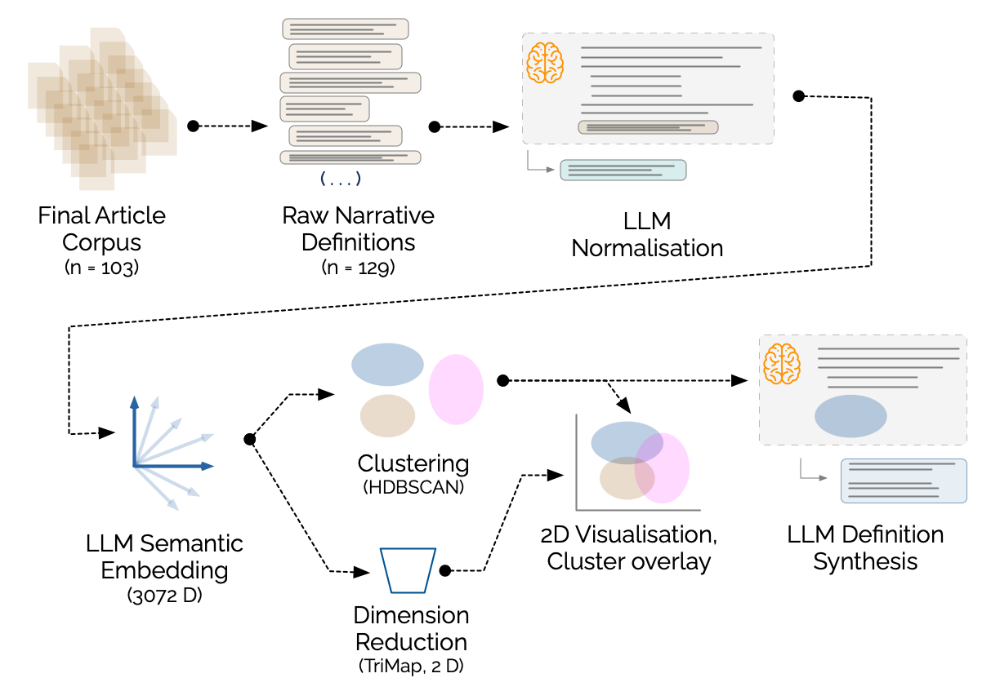

# Analysing Narrative Definitions in Semantic Space

Release v1.0.0, 

Replication code for 

📓 **“What's the Story? A Scoping Review of the Concept of Narratives in Psychological Studies of Ideological Extremism”**

&#x1F58B; By [Silas Ellery (Flinders)](https://www.flinders.edu.au/people/silas.ellery), [Emma F. Thomas (Flinders)](https://www.flinders.edu.au/people/emma.thomas), [Lisette Yip (Flinders)](https://researchnow.flinders.edu.au/en/persons/lisette-yip/), [Simon D. Angus (Monash)](https://research.monash.edu/en/persons/simon-angus), [Winnifred R. Louis (UQ)](https://about.uq.edu.au/experts/1171), [Mengbin Ye (Adelaide)](https://researchers.adelaide.edu.au/profile/ben.ye), and [Ryan Balzan (Flinders)](https://www.flinders.edu.au/people/ryan.balzan).

For queries about the replication code, contact Simon Angus at simon.angus@monash.edu.

## Overview

  

This pipeline analyses definitions of *narrative* in high-dimensional embedding space. It projects embeddings with TriMAP for visualisation, clusters them with HDBSCAN, and uses generative models to synthesise representative definitions within and across clusters.

The workflow comprises data preparation, optional text normalisation, and semantic analysis. Prepared data and cached embeddings can be used directly without repeating preprocessing or embedding API calls.

## Directory guide

The **analysis root is the repository root**, containing this README, `src/`, `configs/`, `normaliser/` and `utils_data_prep/`. Run analysis commands from the repository root: paths in YAML configurations are relative to the working directory, not the YAML file.

| Location | Purpose |
| --- | --- |
| `src/main.py` | Main semantic-analysis command-line entry point |
| `src/pipeline/` | Embedding, projection, clustering, synthesis and plotting components |
| `src/robustness/` | Robustness and embedding-comparison experiments |
| `src/tools/` | Ranking tools for hyperparameter searches |
| `configs/` | YAML experiment settings and data/output paths |
| `prompts/` | Cluster-synthesis and meta-synthesis instructions |
| `data/` | Input tables (tab-separated, including files named `.csv`) |
| `outputs/` | Cached embeddings, figures, metrics, labels and summaries |
| `normaliser/` | Optional Anthropic-based extraction and normalisation of source definitions |
| `utils_data_prep/` | Dataset-specific shell helpers for cleaning text tables |
| `architecture.md` | Detailed platform, dependency and installation troubleshooting advice |

## Installation

Use **Python 3.11** as the compatibility baseline. From the analysis root, create and activate a virtual environment, then install the requirements:

`python3.11 -m venv venv`

`source venv/bin/activate`

`python -m pip install --upgrade pip setuptools wheel`

`python -m pip install -r requirements.txt`

On Windows, use `py -3.11 -m venv venv` and activate with `.\venv\Scripts\Activate.ps1` in PowerShell before running the pip commands.

For architecture-specific profiles, compiler requirements, binary compatibility checks and hashed dependency locks, see [architecture.md](architecture.md). The profiles are compatibility constraints, not independently validated end-to-end platform guarantees or exact reproduction locks.

## Configuration and input

Copy the example environment file and add your own credentials:

`cp .env.example .env`

`OPENAI_API_KEY` is needed to generate OpenAI embeddings; `ANTHROPIC_API_KEY` is needed for the default synthesis provider. Existing embeddings and labels can be used for downstream numerical analysis and plotting without generating new API requests. Never commit or distribute `.env`.

Choose a configuration in `configs/` and check `paths.input_tsv`, `data.text_column` and `data.id_column`. The main input is **tab-separated**, regardless of its filename extension. The default text column is `text_normalised`; the default ID column is `uid` (row indices are used if the ID column is absent). Downstream runs still require the configured input table.

The OpenAI baseline is `configs/baseline_openai.yaml`. `configs/baseline_gemini.yaml` uses the supplied Gemini embedding cache; the main CLI does not generate embeddings for its Gemini model key.

## Quickstart

To analyse the supplied cached OpenAI embeddings and regenerate the projection, clustering and plot without paid API calls:

`python -m src.main --config configs/baseline_openai.yaml --do dimred,cluster`

To run the full OpenAI workflow, including **paid embedding and synthesis requests**:

`python -m src.main --config configs/baseline_openai.yaml --do all`

These commands write into `outputs/` and may replace existing results with the same tag. Preserve the supplied outputs before rerunning experiments. The default tag is the config filename stem; use `--tag my_run` to separate new results. When reusing saved coordinates or labels, use the tag under which they were created.

### Individual stages

Generate OpenAI embeddings (paid; this stage recomputes and writes the cache):

`python -m src.main --config configs/baseline_openai.yaml --do embeddings --models large`

Save a fixed 2D coordinate map from existing embeddings:

`python -m src.main --config configs/baseline_openai.yaml --do dimred --save-dimred-map`

Replot existing coordinates and labels:

`python -m src.main --config configs/baseline_openai.yaml --do visualize`

Plot a variant's existing labels over the saved baseline positions:

`python -m src.main --config configs/openai_variant_1.yaml --do visualise --use-dimred-map outputs/results/baseline_openai_dimred_map_large.json`

Synthesise clusters from existing embeddings and labels (paid):

`python -m src.main --config configs/baseline_openai.yaml --do summarize`

### Hyperparameter tuning

With embeddings already available, tune without requesting fresh embeddings or summaries:

`python -m src.main --config configs/baseline_openai.yaml --do none --tune-trimap`

`python -m src.main --config configs/baseline_openai.yaml --do none --tune-hdbscan`

Rank the resulting searches:

`python src/tools/rank_trimap_results.py outputs/results/baseline_openai_tuning_trimap.json --top 20`

`python src/tools/rank_hdbscan_results.py outputs/results/baseline_openai_tuning_hdbscan.json --top 20 --composite --w-noise 0.5`

The optional HDBSCAN composite score is `silhouette - w_noise * frac_noise`. Without `--composite`, results are ranked by silhouette, with noise fraction as the secondary criterion.

## Preparing new data

These helpers are optional: skip them when using the supplied prepared input. They have hard-coded filenames and settings rather than command-line arguments. Work on copies and inspect the results before analysis.

### `utils_data_prep/`: table-cleaning helpers

Run these scripts from a **scratch directory containing the input files**; their relative filenames refer to the working directory, not the scripts' directory. Invoke them as `sh /absolute/path/to/utils_data_prep/clean_csv.sh` and `sh /absolute/path/to/utils_data_prep/strip_counts.sh`, substituting their actual location.

- `clean_csv.sh` reads `input.csv`, converts Latin-1 to UTF-8 with `iconv`, and uses Perl to replace newlines not followed by three numeric, tab-separated fields. It writes `input_cleaned.csv`. This is a dataset-specific record-boundary heuristic, **not a general CSV parser**. Check both the source encoding and the row pattern before using it; it may alter headers or merge rows in other datasets.

- `strip_counts.sh` reads `input_cleaned.csv` and removes strings matching `(123 words)` with `sed`, writing `input_cleaned_nocounts.csv`. It operates on the whole file, so inspect for unintended removals. Use it after normalisation if the generated definitions include trailing word counts; rename a copy of the normaliser output to its expected input filename first.

The helpers require a POSIX shell and the named utilities (`iconv`, Perl and `sed`); Windows users need a suitable Unix-like environment. Each invocation overwrites its output filename. Check the cleaned table's encoding, header, tab separation and row count before continuing.

### `normaliser/`: normalising source definitions

`normalise_text.py` sends each source passage to Anthropic using `normalise_prompt.md`. The prompt requests a generic 110–140-word definition of narrative, with a trailing word count. The script retains the input columns and row order and adds `text_normalised`.

With a Python environment activated, change into `normaliser/` and install its small, separate dependency set:

`python -m pip install -r requirements.txt`

`cp .env.example .env`

Set `ANTHROPIC_API_KEY` in that local file or your environment. Edit the script's **CONFIG** section before running: set `INPUT_TSV`, `OUTPUT_TSV`, `PROMPT_FILE`, the model, text-column names, `ROW_LIMIT` and `MAX_WORKERS`. Defaults are tab-separated `input.csv` → `output.csv`, reading the `text` column. Run from `normaliser/` so the default prompt path resolves:

`python normalise_text.py`

This makes **paid API requests** and sends the source passages to Anthropic. Start with a small `ROW_LIMIT`, check the generated definitions, then process the full input. Failed rows contain `[ERROR]` text in the output column; inspect and resolve them before analysis. Preserve stable IDs such as `uid`. If removing word counts, apply the helper above to a copy of the output. Finally, place the prepared table in `data/`, set its path and column names in the analysis YAML, and return to the analysis root.

## Outputs and reproducibility

Typical outputs include:

- `outputs/embeddings/embeddings_<model>.parquet`: cached embedding vectors.

- `outputs/results/<tag>_coords_<model>.npy` and `<tag>_labels_<model>.npy`: coordinates and cluster labels.

- `outputs/results/<tag>_trimap.json` and `<tag>_hdbscan.json`: numerical diagnostics.

- `outputs/plots/<tag>_trimap_hdbscan.png` and accompanying CSV: figures and plotted data.

- `outputs/summaries/`: per-cluster summaries and meta-syntheses, with indexes under `outputs/results/`.

### Reproducibility

YAML files set the random seed. The pipeline records effective configuration and package versions in `outputs/results/<tag>_meta.json`. Preserve these metadata, input IDs, cached embeddings, prompts, labels and coordinate maps when comparing runs. Fixed seeds do not guarantee identical numerical results across architectures or dependency versions, and fresh model calls may differ from archived outputs. See [architecture.md](architecture.md#hashed-locks-and-reproducibility) for environment snapshots.

The supplied configurations cover the OpenAI baseline, two clustering variants and cached Gemini embeddings. Robustness and embedding-comparison settings are in `configs/robustness.yaml` and `configs/embedding_comparison.yaml`, with their runners in `src/robustness/`. Historical research outputs are retained; private working logs are not the public usage guide.

HDBSCAN labels noise as `-1`, shown in grey. Representative texts are selected by cosine proximity to the cluster centroid in embedding space. A shared 2D coordinate map aids visual comparison, but overlaying Gemini clusters on OpenAI coordinates does **not** make that map a projection of Gemini topology.

## API credentials and costs

Embedding, normalisation and synthesis stages can incur charges. Check input size, selected models and provider data-handling requirements before sending text. Keep credentials in local environment variables or ignored `.env` files, and apply provider-side project or organisation limits where available.

## Licence

See [LICENSE](LICENSE).
